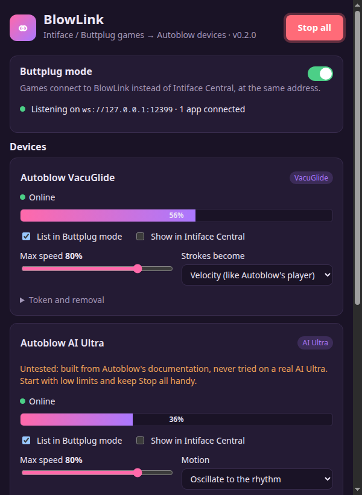
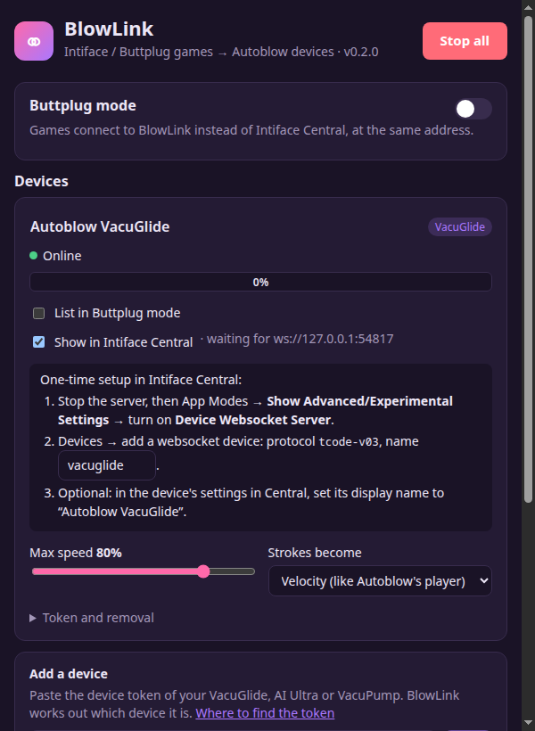

# BlowLink

**Play Intiface / Buttplug games with Autoblow devices.**

[](https://github.com/driftsyncone/blowlink/releases/latest)

[](LICENSE)

<p align="center"></p>

Games and players that support [Intiface / Buttplug](https://buttplug.io) can't reach Autoblow
devices: those are controlled through Autoblow's cloud, not over Bluetooth. BlowLink sits in
between. It takes the game's commands and drives your VacuGlide, AI Ultra or VacuPump through
Autoblow's API.

- **Works with any Buttplug game or app.** Nothing game-specific; tested with stroke games,
  vibrate-only games and Intiface Central itself.
- **Two ways to connect:** games talk to BlowLink directly, or BlowLink joins Intiface Central
  as a device next to your other toys.
- **Turns strokes and vibration into what the device can do**, smoothly and with few API calls.
- **Desktop app** with a tray icon, a *Stop all* button, start at login and in-app updates.

> Unofficial. Not affiliated with Autoblow or the Buttplug / Intiface project.

## Devices

| Device | Status | How commands are played |
|---|---|---|
| **VacuGlide 2** | ✅ Supported | Stroke speed (the API has no position control) |
| **AI Ultra** | ⚠️ Untested | Oscillation over the stroke range, or go-to per move |
| **VacuPump** | ⚠️ Untested | Vacuum level; strokes pulse between your limit and 0 kPa |

AI Ultra and VacuPump support follows Autoblow's documentation but has never run on a real
device. Start with low limits, and please [report](https://github.com/driftsyncone/blowlink/issues)
how it behaves.

## Download

Get the latest version from **[Releases](https://github.com/driftsyncone/blowlink/releases/latest)**.

| System | File | Notes |
|---|---|---|
| Windows | `BlowLink-Setup-x.y.z.exe` | Installs for your user only, no admin. Not code-signed: SmartScreen asks, choose *More info → Run anyway*. |
| Windows (portable) | `BlowLink-Portable-x.y.z.exe` | One file, nothing installed: run it from anywhere (a USB stick works). Settings, including device tokens, stay in a `BlowLink-data` folder next to it; delete the file and folder to remove every trace. It doesn't update itself: the app tells you when a new version is out. A `.zip` of the unpacked app is there too. |
| Linux | `BlowLink-x.y.z-linux-x86_64.AppImage` | `chmod +x`, then run it. Also as `.deb` and `.tar.gz`. |
| macOS | `BlowLink-x.y.z-mac-arm64.dmg` (Apple Silicon) or `-x64.dmg` (Intel) | Not notarised: the first time, open *System Settings → Privacy & Security* and choose *Open Anyway* (on older macOS, right-click the app → *Open*). |

The installer and AppImage versions update themselves from inside the app; the portable exe, zip, deb, tar.gz and macOS versions tell you when there is a new one.

## Getting started

1. **Put the device online:** hold its mode button for 2.5 seconds.
2. **Add it in BlowLink:** paste the device token under *Add a device*. BlowLink asks Autoblow
   which device it is. (Autoblow's [developer docs](https://developers.autoblow.com/) explain
   the token.)
3. **Pick how your game connects:**

### Buttplug mode (simplest)

BlowLink takes Intiface Central's place: games connect to `ws://127.0.0.1:12345` as usual.
Close Intiface Central first, since both use that port. Supports everything games send:
strokes, vibration, stops.

### Intiface mode (with your other toys)



BlowLink joins Intiface Central as a device, so the Autoblow device appears next to your
Bluetooth toys and games keep talking to Intiface. One-time setup in Intiface Central 3:

1. Stop the server, open **App Modes**, turn on **Show Advanced/Experimental Settings**, then
   **Device Websocket Server**.
2. **Devices** → add a websocket device: protocol `tcode-v03`, name as shown on BlowLink's card
   (e.g. `vacuglide`).
3. Start the server, turn **Buttplug mode** off in BlowLink and tick **Show in Intiface
   Central** on the device.

Intiface passes stroke and position commands to this kind of device, not vibration. For
vibrate-only games, use Buttplug mode.

<br clear="right">

## How it plays

Autoblow devices are motors controlled through a cloud API: each change is an internet round
trip, so BlowLink shapes the game's commands into something the device can follow.

- **Strokes become speed.** *Velocity* (default) matches Autoblow's own funscript player:
  faster, deeper strokes run faster. *Tempo* follows strokes per minute and ignores depth. The
  pace is averaged over the last two strokes, so timing jitter doesn't make the speed jump.
- **Vibration becomes speed too.** Rises are sent at once; drops only after half a second, so
  fast on/off patterns play as a steady level instead of stuttering.
- **Stopping is fast:** *Stop all* (window and tray), a game disconnecting and quitting BlowLink
  stop the device at once. A stop command from a game goes out within 0.12 s, so games that
  send a stop before every move don't make the device halt and restart. With strokes, the
  device stops 1.5 s after the last one; in Intiface mode (which sends no stop) that idle
  timeout is the stop. A VacuPump first releases its vacuum (about 3 s) before switching off,
  and BlowLink tries again if Autoblow is rate limiting at that moment.
- **Local only:** the Buttplug server accepts programs on your computer and web pages served
  from `localhost`. A page on the internet cannot connect, so it cannot drive your device. For
  a browser-based game on a website, add its address (e.g. `https://example.itch.zone`, or
  `https://*.itch.zone`) under `buttplug.allowedOrigins` in the settings file; BlowLink's log
  shows the address it refused.
- **API-friendly:** changes are paced, rate limits are respected, and an offline device gets
  one connection attempt plus a *Connect* button instead of endless retries.

**Safety:** set a *Max speed* (or *Max vacuum*) per device and keep the device's own controls
within reach. If your computer or its internet connection drops mid-session, BlowLink cannot
stop the device any more, and it may keep doing its last command (including holding vacuum)
until you stop it on the device itself.

## Troubleshooting

- **"Port 12345 unavailable"**: Intiface Central (or another BlowLink) is running. Close it (BlowLink
  tries again every 10 s), use Intiface mode, or change the port under *Settings → Advanced*.
- **A browser game can't connect**: see *Local only* above.
- **Device shows Offline**: put it in online mode (step 1 above), then press *Connect*.
- **Something feels off with a game**: turn on *Settings → Advanced → Log game messages*, play a
  minute, and attach `blowlink.log` (Settings shows where it is) to an issue.

## Tested against

<details>
<summary>Games and mods BlowLink has been checked with</summary>

Only the VacuGlide has run on real hardware (see *Devices*). "Replayed" means the game's real
traffic was captured and is replayed in the test suite; "simulated" means the pattern the game
sends was worked out from its own toy code and played through BlowLink's tests, without running
the game against it. A game that speaks Buttplug protocol v3 should work either way; these are
the ones that shaped how commands are turned into speed.

| Game | How | What it sends |
|---|---|---|
| Cock Hero | Run live, replayed | A stroke per beat half, plus a vibrate pulse per beat |
| Cycle of Corruption | Run live, replayed | Vibrate-only pattern pulses |
| Heat Control | Run live, replayed | Fast regular strokes, a stop about once a second while idle |
| Fap Hero Journey | Simulated | Funscript position streams, vibration channels |
| Dominatrix Simulator | Simulated | One intensity value sent as position, vibrate and oscillate |
| Dream of JOI | Simulated | A vibrate pulse per note |
| Mousegun | Simulated | A vibrate pulse plus a lone move per event |
| Hunted on Eclipse-9 | Simulated | Slow idle strokes with a stop before each, animation-timed strokes |
| TAI Awakening | Simulated | Held levels, patterns, metronome strokes |

Mods whose output was simulated from their source: LoveMachine, Karryn's Buttplug, Fallen Angel
Marielle, The Villain Simulator bridge, Rumble Party.

Not supported: games that talk to Lovense Remote directly instead of Buttplug/Intiface.

Tried one that behaves badly? Turn on *Settings → Advanced → Log game messages* and open an
issue with the log.

</details>

## Building from source

Requires Node.js 24 (what the release builds use).

```sh
npm install
npm test                 # unit tests, incl. replays of recorded game sessions
npm run build && npx electron .
npm run dist:linux       # or dist:win / dist:mac: packages in dist/
npm run cli -- --help    # headless bridge, no window
```

Releases are built by GitHub Actions from a `vX.Y.Z` tag. Notes come from
[CHANGELOG.md](CHANGELOG.md).

## Credits & license

Started as a bridge for [Cock Hero](https://cockherogame.itch.io/cock-hero). Built on the
[Buttplug](https://buttplug.io) protocol and Autoblow's
[public device API](https://developers.autoblow.com/).

[CC BY-NC-SA 4.0](LICENSE): use, change and share for **non-commercial** purposes, with credit;
anything you build from it must use the same license. Third-party licenses ship with the app
(`THIRD_PARTY_NOTICES.txt`).
